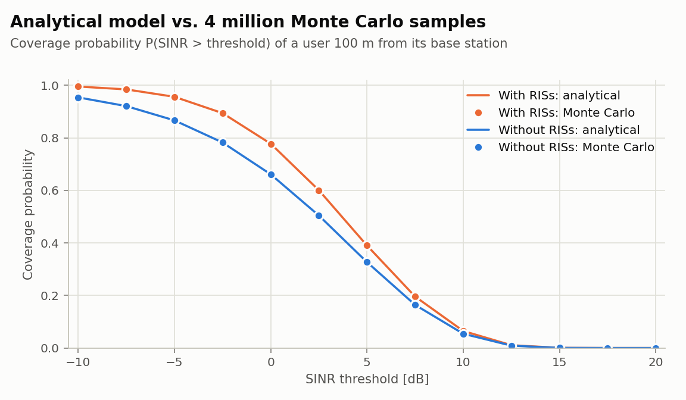
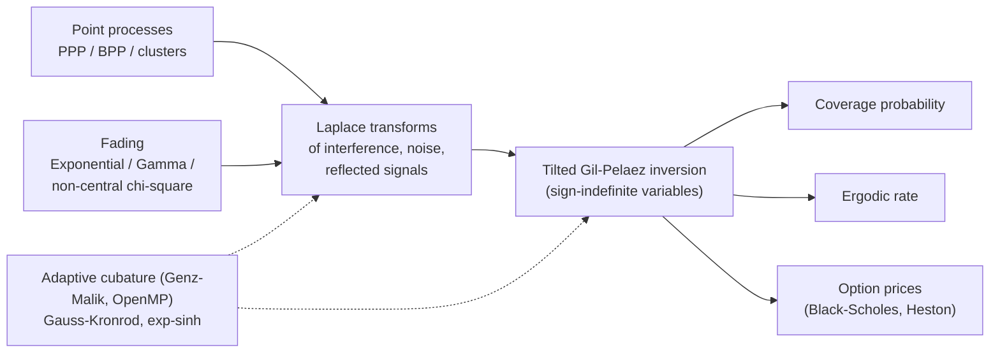
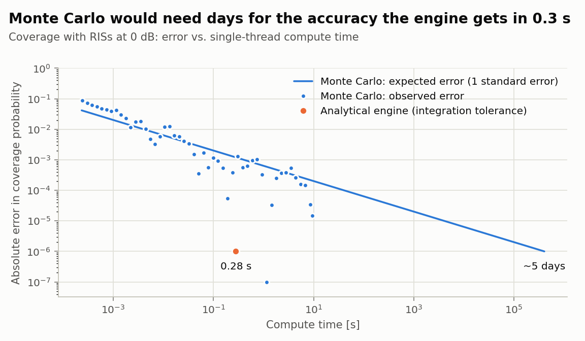
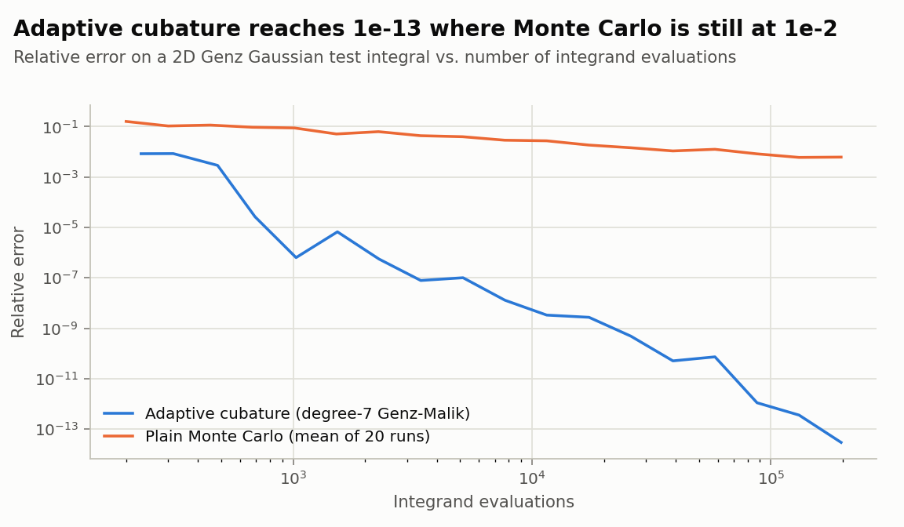
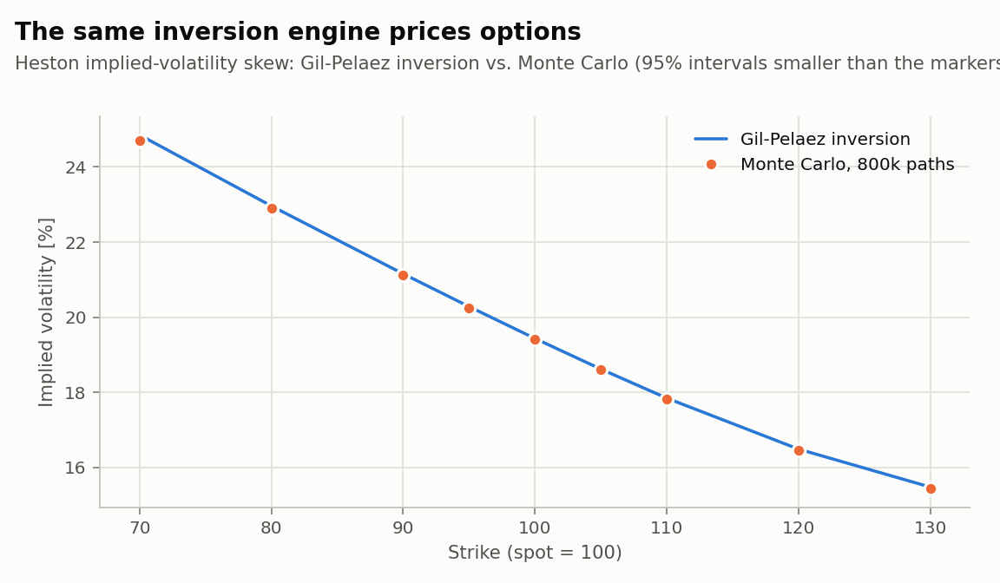

# risgeo: a semi-analytical performance engine for RIS-assisted cellular networks

<!-- CI badge (fill in the repository path once it is on GitHub):
[](https://github.com/OWNER/REPO/actions/workflows/ci.yml) -->
[](https://en.cppreference.com/w/cpp/20)
[](LICENSE)
[](https://doi.org/10.1109/TWC.2025.3621323)
[](https://arxiv.org/abs/2310.06754)

A header-only C++20 library that computes the coverage probability and data rate of large random wireless networks **from Laplace transforms instead of simulation**: microseconds to seconds per result where Monte Carlo needs minutes to days for the same accuracy, validated against 4 million simulated networks. It implements the framework of my paper in *IEEE Transactions on Wireless Communications* (2025), and its inversion engine prices options under Black-Scholes and Heston unchanged.

<picture>
  <source media="(prefers-color-scheme: dark)" srcset="docs/figures/coverage_validation-dark.png">
  
</picture>

| | |
|---|---|
| **Validated** | Analytical results agree with 4 million Monte Carlo samples at all 26 test points (largest deviation 2.1 standard errors); ergodic rates agree within 1.1 standard errors. |
| **Fast** | Coverage with RIS-reflected signals in 0.28 s at 1e-6 tolerance. Monte Carlo needs about 1.7e11 samples, roughly 5 CPU-days, for the same accuracy. |
| **Numerically engineered** | Adaptive multidimensional cubature written from scratch: 3e-14 relative error where Monte Carlo is at 6e-3, and 33x lower bookkeeping overhead after replacing per-step sorting with a heap. |
| **Transferable** | The same Gil-Pelaez inversion prices Black-Scholes options to 1e-13 and reproduces the published Heston benchmark (Fang & Oosterlee 2008) to 10 digits. |

## The problem

Base stations sit at random positions (a Poisson point process), every link fades randomly, and reconfigurable intelligent surfaces (RISs) add reflected signals. The questions an operator asks, *what fraction of users is covered?* and *what data rate do they get?*, are probabilities over all of this randomness: P(SINR > θ) and E[ln(1 + SINR)].

Monte Carlo answers them slowly and noisily. Stochastic geometry answers them through Laplace transforms, but the classical formula P(cov) = L(θ) assumes that the "effective interference" θ(I + N) − R is non-negative. RIS reflections R break that assumption. This library handles the sign-indefinite case with an exponentially tilted Gil-Pelaez inversion,

$$
\mathbb{P}(H > X) \;=\; \tfrac12\bigl(1 + \mathcal{L}_X(1)\bigr) \;+\; \frac{1}{\pi}\int_0^\infty \frac{\operatorname{Im}\bigl[\mathcal{L}_X(1 - iu) - \mathcal{L}_X(-iu)\bigr]}{u}\,du,
\qquad H \sim \mathrm{Exp}(1),
$$

evaluated with double-exponential quadrature. The ergodic rate becomes a smooth 2D integral after the substitution u = e^w, solved by the adaptive cubature. The derivations are in [docs/method.md](docs/method.md).



## Quick start

```bash
cmake -S . -B build && cmake --build build -j && ctest --test-dir build
./build/examples/QuickStart
```

Requirements: a C++20 compiler (GCC 12+, Clang 15+, Apple Clang) and CMake 3.20+. Boost.Math and nlohmann/json are vendored, header-only. OpenMP is used when found (on macOS: `brew install libomp`). Without CMake, `make && make test` does the same.

```cpp
// examples/QuickStart.cpp
#include <cstdio>
#include <risgeo/risgeo.hpp>

int main(){
    using namespace risgeo;
    const double distance = 100.0, BS_density = 1e-5, noise = 1e-13;  // m, BSs per m^2, W

    // Interfering BSs: Poisson point process beyond the serving distance, Rayleigh fading, pathloss exponent 4.
    PoissonPP2D_Reduced interference([](std::complex<double> s, double r){
        return Exponential::eval(s, PathLoss::direct_nlos(r));
    }, BS_density, distance);

    // RISs: on average 5 in the ring [10 m, 25 m] around the user, 200 elements each (CLT-Gaussian amplitude).
    const double N = 200.0;
    PoissonPP2D reflected([&](std::complex<double> s, double y, double theta){
        double variance = Parameter::antenna_gain * N * Parameter::zeta_variance
                          * PathLoss::direct_los(y) * PathLoss::reflected_los(distance, y, theta);
        double non_centrality = N * Parameter::zeta_mean * Parameter::zeta_mean / Parameter::zeta_variance;
        return ChiSquare::eval_non_central(-s, non_centrality, variance);
    }, 5.0 / (M_PI * (25.0 * 25.0 - 10.0 * 10.0)), CUBE::make_cube_2D<double>(10.0, 25.0, 0.0, 2.0 * M_PI));

    std::printf("Coverage at 0 dB: %.4f without RISs, %.4f with RISs\n",
                CoverageProbability::calculate_rayleigh(distance, 1.0, interference, noise),
                CoverageProbability::calculate_rayleigh_positive(distance, 1.0, noise, interference, reflected));
}
```

```
Coverage at 0 dB: 0.6607 without RISs, 0.7772 with RISs
```

## Results

### Accuracy per unit of compute
<picture>
  <source media="(prefers-color-scheme: dark)" srcset="docs/figures/accuracy_vs_time-dark.png">
  
</picture>

Monte Carlo error falls as t^(-1/2). Reaching the engine's 1e-6 tolerance would take about 1.7e11 samples (single core, 2.3 µs per simulated network). The engine evaluates coverage without RISs in 2 µs (one 1D integral) and with RISs in 0.28 s.

### Adaptive cubature vs. Monte Carlo integration
<picture>
  <source media="(prefers-color-scheme: dark)" srcset="docs/figures/cubature_convergence-dark.png">
  
</picture>

### Same engine, different domain: Heston option pricing
<picture>
  <source media="(prefers-color-scheme: dark)" srcset="docs/figures/heston_smile-dark.png">
  
</picture>

With X = ln(S_T/K), a digital call is e^{-rT} P(X > 0) and a call is e^{-rT} K (E[e^X 1{X>0}] − P(X > 0)). These are the same two inversion formulas, with the tilt a = −1 (stock numeraire) instead of a = +1 (Rayleigh fading). See [examples/OptionPricingExample.cpp](examples/OptionPricingExample.cpp).

### Benchmarks
Apple M4 (10 cores), Apple Clang 21, `-O3`. Reproduce with `./build/benchmarks/cubature_benchmark`.

| Adaptive cubature bookkeeping, 3D test integral | sort every step (before) | max-heap (after) |
|---|---:|---:|
| 10k evaluations | 46 ns / eval | 22 ns / eval |
| 100k evaluations | 120 ns / eval | 17 ns / eval |
| 1M evaluations | 482 ns / eval | 15 ns / eval |

| Ergodic rate with RISs (expensive nested integrand) | time |
|---|---:|
| serial build | 9.4 s |
| OpenMP, 4 threads | 2.8 s |
| OpenMP, 10 threads | 2.2 s |

Scaling flattens beyond 4 threads because the 1D Gauss-Kronrod part of the computation is serial (Amdahl's law).

## How the code is organised

```
include/risgeo/
  integration/cuhre/       adaptive N-dimensional cubature: Genz-Malik degree-7 rule, error estimation, OpenMP
  integration/genz_malik/  2D Genz-Malik cubature with float / double / long double tables
  inversion/               Gil-Pelaez inversion: P(X > 0), tilted expectations, Rayleigh coverage, ergodic rate
  laplace/                 Laplace transforms of fading distributions and point processes (PPP, BPP)
  geometry/                coverage probability and ergodic rate of a typical user
  utils/                   pathloss models
examples/                  quick start, the four paper examples, option pricing (examples/finance)
tests/                     regression and consistency tests (CTest)
validation/                Monte Carlo validation in C++ (and the original MATLAB scripts)
benchmarks/                cubature benchmarks and convergence study
paper/                     research drivers behind the published figures (ris_performance, techno_economic)
scripts/make_figures.py    renders docs/figures from docs/data (`make figures` regenerates everything)
third_party/               Boost.Math (header-only subset), nlohmann/json
```

## Engineering notes

- **Validation found a real modelling gap.** The first comparison showed Monte Carlo 0.2% above the analytical coverage at every threshold. The cause was that the simulation drops interferers beyond 3 km while the analytical integral runs to infinity. With matched truncation the residuals are pure noise (largest deviation 2.1 standard errors over 26 points).
- **Serial builds stopped integrating too early.** Without OpenMP, the parallel subdivision counted three regions' evaluations while processing one, so it exhausted its budget early (ergodic rate 1.27605 instead of 1.27658). Counting what actually runs fixed it, and the result now matches the OpenMP value.
- **O(n² log n) to O(n log n).** The cubature re-sorted and re-summed every subregion after each bisection. A max-heap with running totals (exact totals refreshed periodically and before accepting convergence) cut the bookkeeping by 33x at 1M evaluations, with identical results up to summation order.
- **Reproducibility.** The published research data in `paper/ris_performance/simulation_alpha` is reproduced to machine precision (5e-16), and the Monte Carlo programs are deterministic regardless of thread count (fixed per-chunk seeds).

## Research background

The framework and the research drivers in [paper/](paper/README.md) come from my PhD work on RIS-assisted networks:

> G. Sun, F. Baccelli, K. Feng, L. Uzeda Garcia, S. Paris, "A Stochastic Geometry Framework for Performance Analysis of RIS-assisted OFDM Cellular Networks," *IEEE Transactions on Wireless Communications*, 2025. [doi:10.1109/TWC.2025.3621323](https://doi.org/10.1109/TWC.2025.3621323), [arXiv:2310.06754](https://arxiv.org/abs/2310.06754)

The software was written by Guodong Sun; the paper is joint work with the co-authors above. If you use the code, please cite the paper (see [CITATION.cff](CITATION.cff)). The system model and workflow are illustrated in [docs/model_illustration.pdf](docs/model_illustration.pdf) and [docs/workflow.pdf](docs/workflow.pdf).

Contact: guodong.sun1014@gmail.com
